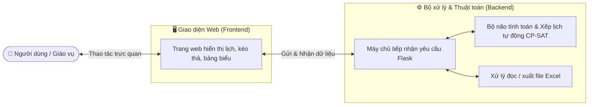

# 📅 VJU-Calendar — Hệ Thống Hỗ Trợ Xếp Thời Khóa Biểu Tự Động

> **Chào mừng bạn đến với dự án VJU-Calendar!**  
> Tài liệu này được biên soạn dành cho các thành viên mới trong đội ngũ phát triển, thầy cô giáo vụ và người dùng muốn tìm hiểu, vận hành hoặc tiếp tục hoàn thiện hệ thống xếp thời khóa biểu của Trường Đại học Việt Nhật (VJU).

---

## 🎯 1. Mục Tiêu Của Dự Án

Việc xếp thời khóa biểu thủ công cho hàng trăm lớp học phần mỗi kỳ luôn là một bài toán rất phức tạp và tốn nhiều thời gian. Giáo vụ phải cân đối rất nhiều điều kiện:
- **Giảng viên thỉnh giảng** chỉ rảnh vào một số khung giờ cố định.
- **Giảng viên cơ hữu** cần phân bổ lịch dạy hợp lý.
- **Sinh viên cùng một lớp/ngành** không thể học 2 môn cùng một lúc.
- **Phòng học** có giới hạn về số lượng, sức chứa và phân bố ở các cơ sở khác nhau.

**VJU-Calendar** ra đời nhằm:
1. **Tự động hóa tính toán:** Ứng dụng "bộ não" giải toán thông minh để tìm ra phương án xếp lịch tối ưu chỉ trong vài giây đến vài phút.
2. **Hỗ trợ điều phối linh hoạt (Bán tự động):** Cho phép giáo vụ dễ dàng kéo-thả, chỉnh sửa thủ công và hệ thống sẽ tự động cảnh báo nếu phát sinh trùng lịch.
3. **Tiết kiệm thời gian & Hạn chế sai sót:** Nhập dữ liệu trực tiếp từ file Excel kế hoạch giảng dạy và xuất ra bảng thời khóa biểu hoàn chỉnh, sẵn sàng sử dụng.

---

## 🏗️ 2. Cấu Trúc Hệ Thống (Dễ hiểu)

Hệ thống được chia thành 2 phần chính hoạt động phối hợp với nhau:



1. **Giao diện Web (Frontend - Thư mục `frontend/`):**
   - Là nơi người dùng thao tác trực tiếp: xem lưới lịch theo tuần, xem danh sách lớp, chọn giờ rảnh cho giảng viên, bấm nút tự động xếp lịch và kéo-thả để chỉnh sửa.
   - Giao diện được thiết kế hiện đại, mang tông màu đỏ đặc trưng của thương hiệu VJU.

2. **Bộ xử lý trung tâm (Backend - Thư mục `webapp/`):**
   - Nhận dữ liệu từ file Excel và lưu trữ trạng thái phiên làm việc.
   - Chứa **bộ não tính toán (Thuật toán CP-SAT)** để tự động giải quyết các ràng buộc phức tạp (không để trùng phòng, trùng giảng viên, trùng giờ sinh viên).
   - Xuất kết quả cuối cùng ra file Excel chuẩn định dạng.

---

## 🛠️ 3. Công Nghệ Sử Dụng

Dự án ưu tiên các công nghệ hiện đại, ổn định và dễ bảo trì:

| Thành phần | Công nghệ chính | Vai trò trong hệ thống |
|---|---|---|
| **Giao diện** | **React + Vite** | Giúp trang web phản hồi tức thì, mượt mà và trực quan. |
| **Kiểu dáng & Màu sắc** | **Tailwind CSS + shadcn/ui** | Tạo nên giao diện đẹp mắt, nhất quán theo phong cách nhận diện VJU. |
| **Máy chủ API** | **Python (Flask)** | Tiếp nhận các thao tác từ giao diện và điều phối các tác vụ. |
| **Bộ não giải toán** | **Google OR-Tools (CP-SAT)** | Thuật toán giải bài toán tối ưu hóa, tự động xếp lịch theo các quy tắc nghiệp vụ. |
| **Xử lý bảng tính** | **Pandas / OpenPyXL** | Đọc dữ liệu từ file Excel đầu vào và xuất file Excel kết quả. |

---

## 🔄 4. Quy Trình Hoạt Động Của Hệ Thống

Quy trình xếp lịch cơ bản trên hệ thống diễn ra qua 4 bước:

```
[Bước 1: Nạp dữ liệu] ──> Nhập file Excel kế hoạch giảng dạy vào hệ thống.
          │
          ▼
[Bước 2: Xếp Giai đoạn 1] ──> Tự động xếp lịch cho Giảng viên thỉnh giảng theo khung giờ họ đã đăng ký.
          │
          ▼
[Bước 3: Xếp Giai đoạn 2] ──> Tự động xếp tiếp Giảng viên cơ hữu & Gán phòng học phù hợp sức chứa.
          │
          ▼
[Bước 4: Tinh chỉnh & Xuất file] ──> Giáo vụ kiểm tra, kéo thả sửa tay nếu cần và xuất ra file Excel.
```

---

## 📂 5. Bản Đồ Thư Mục Dự Án

```text
VJU-Calendar/
├── config/                       # Cấu hình cục bộ
│   ├── backend-example.json      # Mẫu tham số lịch học và solver của Flask
│   ├── frontend-example.json     # Mẫu thiết lập proxy API cho Vite
│   ├── backend.json              # Cấu hình backend thật (tự tạo, Git bỏ qua)
│   └── frontend.json             # Cấu hình frontend thật (tự tạo, Git bỏ qua)
├── frontend/                     # Giao diện React + Vite
│   ├── public/                   # Tài nguyên tĩnh
│   ├── src/
│   │   ├── adapters/             # Chuyển đổi và phân tích dữ liệu từ API
│   │   ├── components/           # Thành phần giao diện dùng chung
│   │   ├── constants/            # Hằng số của giao diện
│   │   ├── context/              # Trạng thái dùng chung của React
│   │   ├── hooks/                # React hooks
│   │   ├── lib/                  # Tiện ích frontend
│   │   ├── presentation/         # Trang, màn hình và thành phần nghiệp vụ
│   │   ├── services/             # Gọi API backend
│   │   ├── App.jsx               # Component gốc
│   │   └── main.jsx              # Điểm khởi tạo React
│   ├── package.json              # Dependencies và script npm
│   └── vite.config.js            # Đọc proxy từ config/frontend.json
├── webapp/                       # Backend Python Flask
│   ├── api/                      # Các endpoint HTTP
│   ├── domain/                   # Quy tắc và xử lý nghiệp vụ
│   ├── app.py                    # Điểm khởi động Flask
│   ├── app_config.py             # Đọc và kiểm tra config/backend.json
│   ├── scheduler_core.py         # Mô hình xếp lịch CP-SAT
│   ├── state.py                  # Trạng thái phiên làm việc
│   ├── snapshot.py               # Lưu và khôi phục dữ liệu nhập tay
│   ├── fate_import.py            # Đọc và chuẩn hóa Excel
│   ├── fate_export.py            # Xuất dữ liệu Excel
│   ├── fate_export_luoi.py       # Xuất lưới thời khóa biểu
│   ├── fate_audit.py             # Kiểm tra dữ liệu Excel
│   ├── fate_lecturers.py         # Đọc danh sách giảng viên
│   ├── kiem_tra_pham_vi.py       # Kiểm tra xếp lịch theo phạm vi
│   ├── kiem_tra_chuyen_di.py     # Kiểm tra tối ưu di chuyển
│   ├── kiem_tra_nhom_sinh_vien.py # Kiểm tra trùng lịch sinh viên
│   └── requirements.txt          # Dependencies Python
├── doc/                          # Tài liệu dự án
│   ├── PHAN-TICH-RANG-BUOC.md
│   ├── QUY-TRINH-NGHIEP-VU-XEP-TKB.md
│   ├── HUONG_DAN_SU_DUNG.docx
│   ├── GIAI-THICH-CAU-HINH-BACKEND.md # Giải thích từng mục trong config/backend.json
│   └── run.md                    # Hướng dẫn chạy và kiểm tra chuyên sâu
├── main.py                       # Khởi chạy cả backend và frontend
├── check_real_fate_data.py       # Công cụ kiểm tra dữ liệu thực
├── .gitignore                    # Danh sách file Git bỏ qua
└── README.md                     # Tài liệu tổng quan
```

---

## 🚀 6. Hướng Dẫn Khởi Chạy (Dành Cho Người Mới)

### Yêu cầu chuẩn bị
Trước khi bắt đầu, hãy đảm bảo máy tính của bạn đã cài đặt:
- **Python** (phiên bản 3.10 trở lên)
- **Node.js** (phiên bản 18 trở lên)

---

### Bước 1: Cài đặt thư viện (Chỉ cần làm lần đầu tiên)

Mở cửa sổ dòng lệnh (Terminal / Command Prompt / PowerShell) và chạy:

**1. Cài đặt thư viện Backend (Python):**
```bash
cd webapp
py -m pip install -r requirements.txt
```

**2. Cài đặt thư viện Frontend (Node.js):**
```bash
cd ../frontend
npm install
```

---

### Bước 2: Chuẩn bị hai file cấu hình

Hai file cấu hình thật luôn nằm trong `config/` ở thư mục gốc dự án (không phụ thuộc vào thư mục bạn chạy lệnh), và đều bị Git bỏ qua:

- `config/backend.json`: quy tắc lịch học, số phòng, giới hạn ngày dạy, khối ca và tham số solver của backend.
- `config/frontend.json`: địa chỉ backend mà Vite chuyển tiếp lời gọi API tới.

Trong thư mục `config/` đã có sẵn hai file mẫu để bạn tham khảo và sao chép:

- `config/backend-example.json` → tạo `config/backend.json` dựa theo mẫu này.
- `config/frontend-example.json` → tạo `config/frontend.json` dựa theo mẫu này.

Bạn có thể giữ nguyên các giá trị trong file mẫu để chạy thử, hoặc nhận cấu hình phù hợp từ người cung cấp hệ thống. Không đưa dữ liệu nhạy cảm lên Git.

Nếu chưa có một hoặc cả hai file cấu hình, khi chạy `py main.py`, chương trình sẽ tạo các file còn thiếu dưới dạng trống rồi dừng. Hãy mở hai file mẫu `*-example.json` trong `config/`, điền nội dung tương ứng vào file thật rồi chạy lại. File cần đúng định dạng JSON; chương trình không ghi đè file đã có.

Muốn hiểu ý nghĩa từng mục trong `config/backend.json`, xem giải thích chi tiết tại `doc/GIAI-THICH-CAU-HINH-BACKEND.md`.

Sau khi sửa một trong hai file cấu hình, hãy dừng chương trình và chạy lại để áp dụng thay đổi. Không đưa hai file cấu hình thật lên Git.

---

### Bước 3: Chạy chương trình

Sau bước 1, cửa sổ dòng lệnh đang ở thư mục `frontend/`. Chạy lệnh sau để trở về thư mục gốc và khởi động cả backend lẫn frontend:

```bash
cd ..
py main.py
```

Chương trình sẽ kiểm tra hai file cấu hình, cài thêm thư viện nếu còn thiếu, tạo lại `frontend/dist` rồi khởi chạy hệ thống. Có thể mở `http://127.0.0.1:5055` để dùng bản giao diện vừa build, hoặc mở đúng địa chỉ frontend do Vite hiển thị trong cửa sổ dòng lệnh (thường là `http://localhost:5173`) để phát triển với hot-reload. Không dùng lại một tiến trình `main.py` cũ sau khi kéo mã mới; hãy dừng và chạy lại để bản build được cập nhật. Khi muốn dừng, nhấn `Ctrl+C`.

---

## ✨ 7. Các Tính Năng Nổi Bật

1. **Lưới Thời Khóa Biểu Trực Quan:** Xem lịch học theo dạng tuần, lọc theo từng Giảng viên, từng Phòng học hoặc từng Chương trình đào tạo.
2. **Kéo - Thả Điều Chỉnh:** Cho phép giáo vụ di chuyển ca học trực tiếp trên lưới lịch.
3. **Cảnh Báo Xung Đột Tức Thì:** Tự động phát hiện và cảnh báo màu đỏ nếu phát sinh trùng giờ giảng viên hoặc trùng phòng.
4. **Xếp Lịch Linh Hoạt Theo Phạm Vi:** Có thể xếp lịch cho toàn trường hoặc xếp riêng cho từng Chương trình đào tạo / Khóa sinh viên.
5. **Hoàn Tác (Undo / Redo):** Dễ dàng quay lại trạng thái trước đó nếu lỡ thao tác nhầm.
6. **Kiểm Tra Lỗi File Excel:** Tự động chỉ ra các dòng dữ liệu bị thiếu hoặc trùng lặp mã lớp ngay khi tải file lên.

---

## 🤝 8. Hỗ Trợ & Đóng Góp

- Nếu gặp sự cố trong quá trình cài đặt hoặc vận hành, bạn có thể kiểm tra thêm tài liệu chi tiết tại:
  - `doc/run.md`: Hướng dẫn kỹ thuật và lệnh kiểm thử sâu.
  - `doc/QUY-TRINH-NGHIEP-VU-XEP-TKB.md`: Quy trình nghiệp vụ đào tạo chi tiết.
  - `doc/GIAI-THICH-CAU-HINH-BACKEND.md`: Giải thích từng tham số trong `config/backend.json`.
- Chúc bạn có trải nghiệm làm việc hiệu quả và thuận lợi cùng **VJU-Calendar**! 🎉